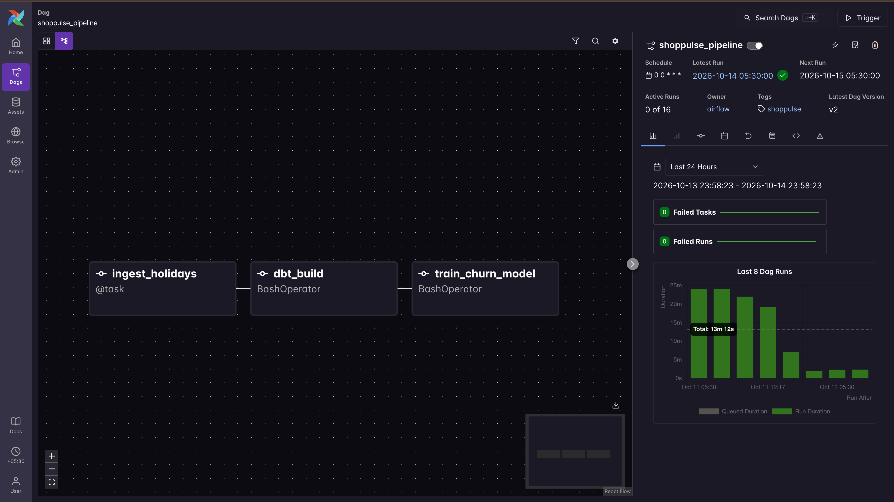
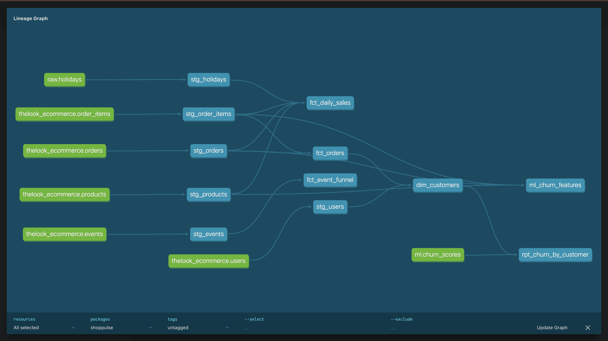
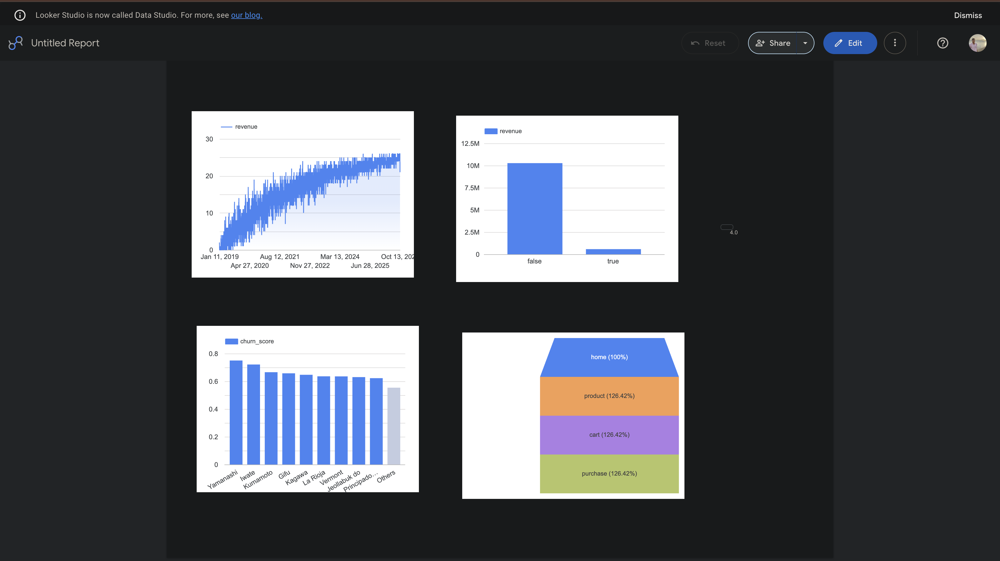

# ShopPulse

End-to-end e-commerce data pipeline: Airflow ingests raw data, dbt models it in BigQuery into tested tables, a churn model trains on the result, and a dashboard reads the output.

**[Live dashboard →](https://datastudio.google.com/reporting/0e35bd0f-5b87-4f01-a850-e90d6c4051e2)** — revenue trend, holiday vs. non-holiday sales, churn risk by segment, web-event funnel.

## Architecture

```text
Nager.Date API ──┐
                  ├─► raw.holidays (BigQuery) ─┐
TheLook public ───┘                            │
dataset (BigQuery, queried directly)           │
        │                                      │
        ▼                                      │
   dbt staging models (rename/cast only)       │
        │                                      │
        ▼                                      │
   dbt mart models ◄────────────────────────────┘
   (fct_orders, dim_customers, fct_daily_sales,
    ml_churn_features)
        │
        ├─► ml/train.py (scikit-learn) ─► ml.churn_scores
        │
        └─► Looker Studio dashboard

All orchestrated daily by one Airflow DAG:
  ingest_holidays -> dbt_build -> train_churn_model
```

## Stack

- **Warehouse:** BigQuery (Sandbox mode, no billing account)
- **Transformation:** dbt Core + dbt-bigquery
- **Orchestration:** Apache Airflow via Astro CLI (Docker)
- **ML:** Python, pandas, scikit-learn (RandomForest)
- **CI:** GitHub Actions (ruff, sqlfluff, pytest)
- **Dashboard:** Looker Studio

## Data sources

- `bigquery-public-data.thelook_ecommerce` — TheLook eCommerce (BigQuery public dataset): users, products, orders, order_items, events
- [Nager.Date public holidays API](https://date.nager.at/Api) — `GET /api/v3/PublicHolidays/{year}/{countryCode}`, ingested daily via Airflow into `raw.holidays`

## Repo layout

- `dags/` — the Airflow DAG (`shoppulse_dag.py`)
- `include/` — shared, unit-tested Python used by the DAG (holiday API client)
- `dbt/` — dbt project: `models/staging` (1:1 renamed/cast sources), `models/marts` (fact/dim tables + churn features), `profiles/` (container-side, env-var-only profile)
- `ml/` — churn model training script
- `tests/` — pytest unit tests for the holiday parser and churn feature pipeline

## Setup

1. Create a GCP project, enable BigQuery Sandbox mode (no credit card).
2. Create a service account with **BigQuery Data Editor** + **BigQuery Job User** roles, download its JSON key, and store it **outside this repo** (e.g. `~/.config/gcloud/<project>-keys/`). Never commit it — see `.gitignore`.
3. Install Docker Desktop and the [Astro CLI](https://www.astronomer.io/docs/astro/cli/install-cli/).
4. Copy `docker-compose.override.yml.example` to `docker-compose.override.yml` and point the volume at the directory holding your key file (this mounts it read-only into the Airflow scheduler container).
5. Create a `.env` file (gitignored) with:

   ```text
   GCP_KEY_FILENAME=<your-key-filename>.json
   DBT_GCP_PROJECT=<your-gcp-project-id>
   DBT_GCP_DATASET=shoppulse_dev
   ```

6. Create `~/.dbt/profiles.yml` (outside the repo) pointing `type: bigquery`, `method: service-account`, your project/dataset, and the keyfile path — used for running `dbt build` from your host machine directly.
7. `astro dev start` — builds the image (installs `requirements.txt`) and brings up Airflow at `http://shoppulse.localhost:<port>` (Astro picks a free port; check the CLI output).
8. In the Airflow UI, unpause `shoppulse_pipeline` and trigger it, or run `astro dev run dags trigger shoppulse_pipeline`.

## Design decisions

- **BigQuery Sandbox mode disallows DML.** The plan originally called for a per-year `DELETE FROM ... WHERE year = @year` before each insert. Sandbox mode (no billing account) rejects all DML with a 403. Instead, `ingest_holidays` pulls the full year range every run and overwrites `raw.holidays` in one `WRITE_TRUNCATE` load job — same idempotency guarantee (a rerun always lands at the same end state, never duplicates), just at table granularity instead of per-year.
- **The plan's holidays API URL was wrong.** `nagerholidays.com/api/v4` doesn't resolve. The real, live API is `date.nager.at/api/v3`. Verified directly before writing any ingestion code.
- **Holidays must be deduped by date before joining.** Some dates carry multiple state-specific public holidays (e.g. a different "Labour Day" per state on the same day). Joining `fct_daily_sales` directly against raw holiday rows fanned out the grain and broke its uniqueness test. Fixed by grouping holidays to one row per date (`string_agg` of names) before the join.
- **`recency_days` is excluded from the churn model's features.** `is_churned` is partly *defined* as `recency_days > 90` in the dbt model. Including it as a training feature let the model trivially learn that rule, producing a suspicious, meaningless 1.0 precision/recall/ROC-AUC. Removing it gives honest numbers: precision 0.945, recall 0.347, ROC-AUC 0.685 — real predictive signal from frequency, monetary value, and category mix alone, not a restatement of the label.
- **Churn features are a single-snapshot design**, not a time-split forecast. All RFM + category-mix features and the `is_churned` label are computed against the same `CURRENT_DATE()` in one dbt run, so nothing is computed from data "after" the point the label is drawn from.
- **BigQuery Storage API calls are disabled in `ml/train.py`** (`create_bqstorage_client=False`). The service account only has Data Editor + Job User roles; the faster Storage API read path needs an extra `bigquery.readsessions.create` permission it doesn't have. The plain REST fallback is fast enough at this table size, and avoids granting a broader role just for a convenience path.
- **dbt credentials reach the Airflow container via a volume mount**, not by embedding key JSON into Airflow Variables — keeps the actual secret bytes out of Airflow's metadata DB and out of anything this assistant would need to read/handle directly.
- **No `unique` test on `users.email`.** 10,653 duplicate emails exist in the synthetic TheLook data — expected, not a bug. Adding the test would fail every build for no actionable reason.

## Screenshots

| Airflow graph | dbt lineage | Dashboard |
| --- | --- | --- |
|  |  |  |

## Data quality

66 dbt tests across 12 models (staging + marts): primary-key uniqueness, referential integrity (`relationships`) between every fact and its dimension, `accepted_values` on every closed enum (order/item status, gender, event_type), numeric range checks (no negative prices, ages 0–110, revenue ≥ 0), row-count parity between staging and marts (nothing silently dropped in a join), and grain-uniqueness checks on the daily sales table. Boundary cases (negative prices, orphaned foreign keys, inverted timestamps, out-of-range values) were manually probed against the live data before writing the corresponding tests, not just checkbox-added. `dbt build` passes 78/78.

## What's next at scale

TheLook is small — this pipeline hasn't been tested past ~125K orders. At Kogan's scale (10M+ events/day) the changes would be: incremental dbt models instead of full-table rebuilds, date-partitioned and clustered BigQuery tables, and an event stream (Kafka/Pub/Sub) instead of a daily batch DAG. Swapping the `dbt_build` BashOperator for Astronomer Cosmos (one Airflow task per dbt model, instead of one opaque task for the whole run) and adding MLflow for experiment tracking would also be the next two infrastructure upgrades.
